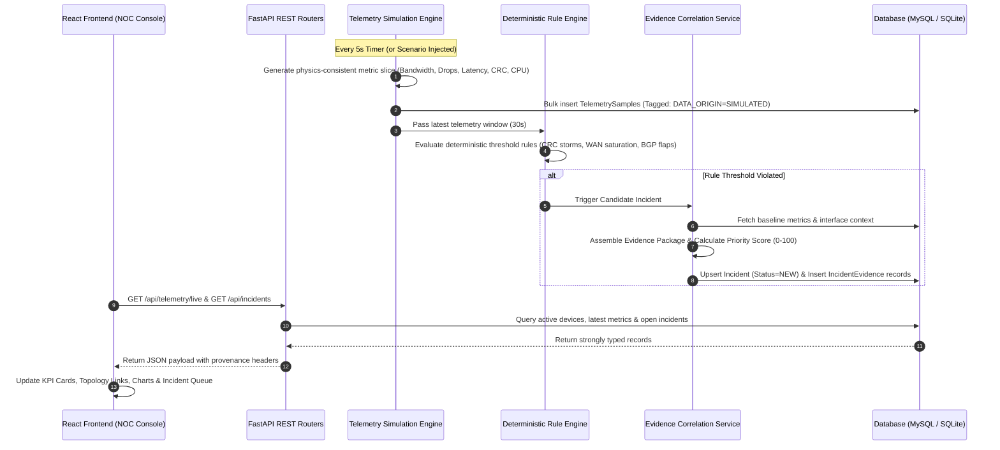
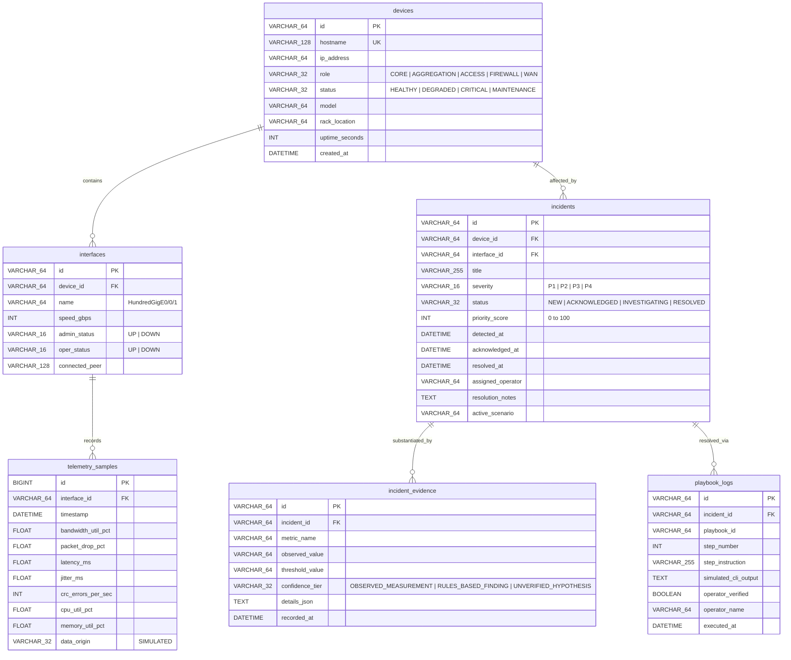

# System Architecture Specification (ARCHITECTURE.md)
# NetOps Intelligence: Modular Monolith Observability & Triage Platform

**Document Version:** 1.0.0  
**Phase:** 3 — Technical Architecture  
**Approved PRD Reference:** [`PRD.md`](file:///C:/Users/lenovo/.gemini/antigravity/scratch/netops-intelligence/PRD.md)  
**Approved Design System:** [`DESIGN.md`](file:///C:/Users/lenovo/.gemini/antigravity/scratch/netops-intelligence/DESIGN.md)  
**Status:** Complete — Pending User Review & Approval  

---

## 1. Approved Technology Stack & Architecture Rationale

NetOps Intelligence is engineered as a **cohesive Modular Monolith**. The architecture provides the simplest reliable implementation for local execution on a Windows workstation while maintaining clean internal domain boundaries.

```
+--------------------------------------------------------------------------------------------------+
|                                    NETOPS INTELLIGENCE MONOLITH                                  |
|                                                                                                  |
|   +---------------------------------------+      +-------------------------------------------+   |
|   |          FRONTEND SUBSYSTEM           |      |             BACKEND SUBSYSTEM             |   |
|   |       (React 19 + TypeScript + Vite)  |      |         (FastAPI + Python 3.14)           |   |
|   |  - NOC Dashboard & KPI Cards          |      |  - REST API Routers (/api/...)            |   |
|   |  - Device Inventory & Topology Visual |      |  - Deterministic Rules Detection Engine   |   |
|   |  - Incident Triage & Evidence Viewer  | <==> |  - Telemetry Physics Simulation Engine    |   |
|   |  - Advisory Playbook Runner           | HTTP |  - Evidence Correlation & Scoring Service |   |
|   |  - Live Scenario Injection Bar        | REST |  - Advisory Playbook Service              |   |
|   |  - Client Store / Mock Adapter        |      |  - SQLAlchemy 2.0 Data Access Layer       |   |
|   +---------------------------------------+      +-------------------------------------------+   |
|                                                                    |                             |
|                                                                    v                             |
|                                                  +-------------------------------------------+   |
|                                                  |             PERSISTENCE LAYER             |   |
|                                                  |   MySQL 8.0 Primary (or SQLite Fallback)  |   |
|                                                  +-------------------------------------------+   |
+--------------------------------------------------------------------------------------------------+
```

### 1.1 Technology Choices & Justification

| Layer | Approved Technology | Justification & Architectural Rationale |
| :--- | :--- | :--- |
| **Frontend Framework** | **React 19 + TypeScript 5+** | Industry standard for enterprise monitoring consoles; strict typing eliminates runtime data mismatch errors between API contracts and UI components. |
| **Build & Dev Tool** | **Vite 6+** | Sub-second Hot Module Replacement (HMR); instant local startup; native ES module bundling with zero webpack overhead. |
| **Styling & Design System**| **Tailwind CSS 3.4+** | Utility-first CSS enables exact implementation of the high-density NOC dark palette (`#080B11`, `#0E1420`) and custom semantic status tokens without CSS bloat. |
| **Icons** | **Lucide React** | Consistent, tree-shakeable SVG icons for multi-channel state encoding (geometric badges, severity glyphs). |
| **Charts** | **Recharts 2.x** | Maintained, responsive React charting library with built-in dual-axis support, reference threshold lines, and SVG canvas rendering optimized for streaming updates. |
| **Backend Runtime** | **Python 3.14+** | Native support for network telemetry processing, asynchronous I/O, mathematical correlation, and future statistical/ML extensions. |
| **Web Framework** | **FastAPI 0.115+** | High-performance asynchronous REST API framework; automatic OpenAPI documentation generation (`/docs`); native Pydantic v2 validation. |
| **Data Validation** | **Pydantic v2** | Strict runtime schema enforcement for incoming/outgoing telemetry packets and incident payloads. |
| **ORM / Data Layer** | **SQLAlchemy 2.0 (Async/Sync)** | Type-safe SQL abstraction providing seamless portability between MySQL 8.0 and SQLite. |
| **Primary Database** | **MySQL 8.0** | Relational ACID store with native JSON column support; matches the active `MySQL80` service verified on the host. |
| **Fallback Database** | **SQLite 3 (`netops_local.db`)** | Automatic, zero-configuration local fallback if MySQL credentials are not yet configured on the developer workstation. |

### 1.2 Architectural Boundary: Modular Monolith vs. Microservices
* **Microservices, Kubernetes, Docker, and Message Brokers (Kafka/RabbitMQ) are explicitly rejected for the MVP:**
  - Introducing container clusters or distributed brokers on a single Windows laptop adds heavy resource contention, complex networking setup, and orchestration fragility.
  - A Modular Monolith provides in-process method execution, sub-millisecond query response times, simple debugging, and zero deployment friction.

---

## 2. End-to-End Request & Data Flow

The platform executes a continuous, deterministic data processing cycle every **5 seconds** (or on operator demand):



### Data Pipeline Stages:
1. **Simulation Tick:** The `TelemetryEngine` computes synthetic metrics adhering to physical network relationships (e.g., CRC errors induce packet discards; high bandwidth queueing induces latency spikes).
2. **Persistence:** Raw samples are recorded with `data_origin="SIMULATED"`.
3. **Rule Evaluation:** The `RuleEngine` inspects the trailing sliding window. If thresholds are breached across consecutive samples, an anomaly event is raised.
4. **Evidence Correlation & Blast-Radius Scoring:** The `EvidenceCorrelator` attaches observed metric values, computes the 0–100 Priority Score, and generates hypotheses tagged with `UNVERIFIED HYPOTHESIS`.
5. **UI Rendering:** The React frontend polls the REST API (or uses client-side simulation in Phase 1 standalone mode) and renders high-density cards, charts, and tables.

---

## 3. Module Boundaries & Proposed Folder Structure

The project maintains clean modular separation between frontend presentation, backend business logic, and shared contracts:

```
netops-intelligence/
├── .env.example                  # Environment configuration template
├── README.md                     # Local setup & quickstart runbook
├── PRD.md                        # Authoritative product requirements
├── DESIGN.md                     # Authoritative UX & design system
├── ARCHITECTURE.md               # Authoritative technical architecture
├── docs/                         # Synchronized specification mirrors
│   ├── PRD.md
│   ├── DESIGN.md
│   ├── ARCHITECTURE.md
│   └── PHASED_PLAN.md
├── frontend/                     # React 19 + TypeScript + Vite Application
│   ├── index.html
│   ├── package.json
│   ├── tsconfig.json
│   ├── tsconfig.node.json
│   ├── vite.config.ts
│   ├── tailwind.config.js
│   ├── postcss.config.js
│   └── src/
│       ├── main.tsx
│       ├── App.tsx
│       ├── index.css
│       ├── types/                # TypeScript Domain Interfaces
│       │   ├── device.ts
│       │   ├── telemetry.ts
│       │   ├── incident.ts
│       │   ├── evidence.ts
│       │   └── playbook.ts
│       ├── components/
│       │   ├── common/           # Header, HealthBadge, LineagePill, StatusGlyph
│       │   ├── dashboard/        # KPIGrid, TopologySummary, LiveAlertFeed
│       │   ├── topology/         # TieredTopologyMap (Core/Agg/Access/WAN)
│       │   ├── telemetry/        # TimeSeriesChart, Sparkline, AnomalyTooltip
│       │   ├── incidents/        # IncidentTable, FilterToolbar, SeverityPill
│       │   ├── evidence/         # EvidenceInspector, MeasurementsTable, HypothesisCard
│       │   ├── playbooks/        # PlaybookModal, DiagnosticTerminal, StepChecklist
│       │   └── simulation/       # ScenarioInjectionBar, ResetControl
│       ├── services/
│       │   ├── api.ts            # Axios/Fetch HTTP REST client
│       │   └── mockData.ts       # Self-contained simulation store (Phase 1 standalone)
│       └── store/
│           └── useNetOpsStore.ts # Central reactive UI state
└── backend/                      # Python FastAPI Modular Monolith
    ├── requirements.txt
    ├── app/
    │   ├── __init__.py
    │   ├── main.py               # FastAPI entrypoint, middleware, CORS, lifecycle
    │   ├── config.py             # Pydantic Settings (.env configuration)
    │   ├── database.py           # Dual-engine connection (MySQL 8.0 with SQLite fallback)
    │   ├── models/               # SQLAlchemy ORM Data Models
    │   │   ├── __init__.py
    │   │   ├── device.py
    │   │   ├── interface.py
    │   │   ├── telemetry.py
    │   │   ├── incident.py
    │   │   └── playbook.py
    │   ├── schemas/              # Pydantic v2 Request/Response Schemas
    │   │   ├── __init__.py
    │   │   ├── device.py
    │   │   ├── telemetry.py
    │   │   ├── incident.py
    │   │   └── scenario.py
    │   ├── routers/              # REST API Controllers
    │   │   ├── __init__.py
    │   │   ├── health.py         # GET /api/health
    │   │   ├── devices.py        # GET /api/devices, /api/devices/{id}
    │   │   ├── telemetry.py      # GET /api/telemetry/live, /history
    │   │   ├── incidents.py      # GET /api/incidents, PATCH /api/incidents/{id}/status
    │   │   ├── evidence.py       # GET /api/incidents/{id}/evidence
    │   │   ├── playbooks.py      # GET /api/playbooks, POST /api/playbooks/{id}/execute
    │   │   └── scenarios.py      # POST /api/scenarios/inject, /reset
    │   └── services/             # Core Domain Business Logic
    │       ├── __init__.py
    │       ├── simulation.py     # Physics-consistent synthetic telemetry engine
    │       ├── rule_engine.py    # Deterministic incident detection engine
    │       ├── correlation.py   # Multi-metric evidence linkage & blast-radius scoring
    │       └── playbook_runner.py# Read-only simulated diagnostic execution
    └── tests/                    # Backend Automated Test Suite
        ├── __init__.py
        ├── conftest.py
        ├── test_api_health.py
        ├── test_devices.py
        ├── test_rules_engine.py
        └── test_incidents.py
```

---

## 4. REST API Conventions & Schema Validation

### 4.1 Global API Standards
- **Base URI:** `/api/v1` (with alias `/api` for convenience)
- **Content-Type:** `application/json; charset=utf-8`
- **Timestamp Standard:** ISO 8601 UTC with trailing `Z` (e.g. `2026-10-18T11:24:00Z`)
- **Error Format (RFC 7807):**
  ```json
  {
    "status": 404,
    "title": "Device Not Found",
    "detail": "Device with ID 'dev-agg-99' does not exist in inventory.",
    "error_code": "DEVICE_NOT_FOUND",
    "timestamp": "2026-10-18T11:24:00Z"
  }
  ```

### 4.2 Endpoint Catalog

| Method | Path | Summary & Description | Request Body | Response Schema |
| :--- | :--- | :--- | :--- | :--- |
| `GET` | `/api/health` | Service health & database connectivity status | None | `HealthResponse` |
| `GET` | `/api/devices` | List managed devices with role/status filters | Query params | `List[DeviceSummary]` |
| `GET` | `/api/devices/{id}` | Detailed device metadata & interface table | None | `DeviceDetail` |
| `GET` | `/api/telemetry/live` | Latest telemetry sample for all active interfaces | None | `List[TelemetrySlice]` |
| `GET` | `/api/telemetry/history` | Rolling time-series window for charts | `?intf_id=&window=5m` | `TelemetryHistoryResponse` |
| `GET` | `/api/incidents` | List incidents with severity/status filters | Query params | `List[IncidentSummary]` |
| `GET` | `/api/incidents/{id}` | Single incident details | None | `IncidentDetail` |
| `PATCH`| `/api/incidents/{id}/status` | Update incident lifecycle (`ACK`, `INVESTIGATING`, `RESOLVED`) | `IncidentStatusUpdate` | `IncidentDetail` |
| `GET` | `/api/incidents/{id}/evidence` | Evidence package (observed metrics, rules, charts) | None | `EvidencePackageResponse` |
| `GET` | `/api/playbooks/{id}` | Fetch guided troubleshooting steps for incident | None | `PlaybookResponse` |
| `POST` | `/api/playbooks/{id}/execute-step` | Execute simulated read-only diagnostic check | `StepExecutionRequest` | `StepResultResponse` |
| `POST` | `/api/scenarios/inject` | Trigger simulated failure scenario | `ScenarioInjectRequest`| `ScenarioStatusResponse` |
| `POST` | `/api/scenarios/reset` | Reset all metrics to healthy normal baseline | None | `ScenarioStatusResponse` |

---

## 5. Database Architecture, Schema & Dual-Engine Fallback

### 5.1 Dual-Engine Connection Strategy
To prevent local database authentication barriers from impeding development on Windows:
1. `backend/app/database.py` initializes an engine targeting MySQL 8.0 using `PyMySQL`:
   `mysql+pymysql://root:@127.0.0.1:3306/netops_db?charset=utf8mb4`
2. If MySQL connection times out or authentication fails, the connection manager **automatically and gracefully activates SQLite fallback**:
   `sqlite:///./backend/netops_local.db`
3. A clear log message is emitted:  
   `[DB-INIT] MySQL unreachable. Gracefully falling back to local SQLite: ./backend/netops_local.db`
4. Schema tables are automatically created on startup via `Base.metadata.create_all(bind=engine)`.

### 5.2 Relational Schema Definition



---

## 6. Authentication & Authorization Architecture

> [!IMPORTANT]
> **Authentication Scope Decision (Grounded in PRD Section 7):**  
> In accordance with project boundaries, **user login, passwords, session cookies, OAuth/SSO, and database-backed RBAC are explicitly OUT OF SCOPE for the MVP**.

### 6.1 Operator Identity Pattern
* The application runs in **Demonstrable Single-Operator Mode**.
* The UI includes a lightweight **Persona Switcher** in the top navigation bar:
  - `Alex (NOC Tier-1)` [Default]
  - `Jordan (IT Lead / Evaluator)`
* The active persona is stored in frontend reactive state (`useNetOpsStore`) and transmitted to the backend via an optional HTTP request header:
  `X-Operator-Id: Alex (NOC Tier-1)`
* When incident status transitions (`ACK`, `RESOLVE`) or playbook steps occur, the backend records the value of `X-Operator-Id` in the audit log. No authentication middleware blocks access.

---

## 7. Error Handling, Structured Logging, Configuration & Security Boundaries

### 7.1 Configuration Management
* Configuration is managed via Pydantic `BaseSettings` (`backend/app/config.py`).
* All settings load from `.env` with fallback to safe local defaults.
* **Zero secrets** exist in source code. `.env.example` serves as the template.

### 7.2 Structured Logging & Audit Trails
* Standardized JSON logger configured on startup.
* Logs emit timestamp, log level, module name, operator context, and execution time:
  ```json
  {"timestamp": "2026-10-18T11:24:00Z", "level": "INFO", "module": "rule_engine", "event": "RULE_TRIGGERED", "rule_id": "CR_002", "incident_id": "INC-2026-001", "device": "AGG-SW01"}
  ```

### 7.3 CORS & Trust Boundaries
* FastAPI CORS middleware strictly limits origins to local development servers:
  `http://localhost:5173` and `http://127.0.0.1:5173`.
* Client inputs (search queries, scenario injection IDs, status updates) are validated against Pydantic enum classes; arbitrary string injections are rejected.

---

## 8. Telemetry Provider & Extensibility Boundaries

### 8.1 Telemetry Provider Abstraction
To enforce strict separation between simulation and potential future telemetry sources:

```python
# Conceptual Interface in backend/app/services/simulation.py
from abc import ABC, abstractmethod
from typing import List
from app.schemas.telemetry import TelemetrySlice

class ITelemetryProvider(ABC):
    @abstractmethod
    def get_live_metrics(self) -> List[TelemetrySlice]:
        """Fetch current telemetry slice across managed topology."""
        pass

    @abstractmethod
    def set_scenario(self, scenario_name: str) -> None:
        """Inject failure scenario into telemetry generation."""
        pass

    @abstractmethod
    def reset(self) -> None:
        """Reset telemetry generation to normal healthy baseline."""
        pass
```

* **Current Implementation:** `SimulatedTelemetryProvider` evaluates mathematical models (random walk + scenario bias).
* **Future Extension Boundary:** A `RealTelemetryAdapter` (utilizing SNMP polling, gNMI telemetry streams, or Prometheus exporters) can implement `ITelemetryProvider` without requiring any changes to the rules engine, database models, or UI components.

---

## 9. Rules Engine & Future ML Extension Boundary

### 9.1 Rules Engine Interface
Incident detection is strictly deterministic in the MVP:

```python
# Conceptual Interface in backend/app/services/rule_engine.py
from abc import ABC, abstractmethod
from typing import List, Optional
from app.models.telemetry import TelemetrySample
from app.models.incident import Incident

class IRule(ABC):
    rule_id: str
    name: str
    severity: str
    
    @abstractmethod
    def evaluate(self, window_samples: List[TelemetrySample]) -> Optional[dict]:
        """Returns finding dictionary if rule threshold breached; None otherwise."""
        pass
```

### 9.2 Concrete MVP Rules
1. `CRCStormRule (CR_002)`: Fired when CRC error rate $> 50\text{ err/s}$ for 3 consecutive samples. (Hypothesis: Dirty fiber end-face or failing optical SFP).
2. `WANCongestionRule (WAN_001)`: Fired when bandwidth $> 90\%$ AND drop rate $> 5\%$. (Hypothesis: Buffer exhaustion due to peak transit backup).
3. `BGPFlapRule (BGP_003)`: Fired when routing peering flaps $> 2$ times within 60s. (Hypothesis: Asymmetric keepalive timeout or route-map mismatch).
4. `CPUSpikeRule (CPU_004)`: Fired when control-plane CPU $> 85\%$ for $> 30$ seconds. (Hypothesis: Broadcast storm or un-throttled control traffic).

### 9.3 Future ML Extension Boundary (Phase 6 Architecture)
* An optional `StatisticalAnomalyDetector` can hook into the telemetry stream to compute rolling Z-scores ($Z = \frac{x - \mu}{\sigma}$) and Interquartile Range (IQR) outliers.
* Any anomalies generated by ML models must be explicitly tagged as `STATISTICAL_BASELINE_OUTLIER` and categorized as `UNVERIFIED_HYPOTHESIS`. They are strictly advisory and never reported as root-cause facts.

---

## 10. Safety Boundary: Advisory Diagnostics Guarantee

> [!CAUTION]
> **Non-Destructive Operations Boundary:**  
> The backend **contains no networking libraries (e.g. Netmiko, Paramiko, Scrapli) that execute write/configuration commands** against hardware.

1. **Playbook Execution Sandbox:**  
   The `PlaybookRunner` service only executes simulated diagnostic routines (`show interface details`, `show ip bgp summary`, `ping <ip>`).
2. **Operator-in-the-Loop Verification:**  
   No incident can transition to `RESOLVED` automatically. An operator must inspect the diagnostic findings, check the confirmation box, and provide resolution sign-off.

---

## 11. Testing & Verification Strategy

### 11.1 Frontend Testing
- **Unit & Component Testing:** Vitest + React Testing Library for isolated component rendering (KPI cards, severity badges, incident tables).
- **Type Checking:** `npm.cmd run build` executes `tsc --noEmit` to verify 100% TypeScript type safety.

### 11.2 Backend Testing
- **API Integration Tests:** Pytest + FastAPI `TestClient` (HTTPX) validating endpoints (`/api/health`, `/api/devices`, `/api/incidents`, `/api/scenarios`).
- **Rules Engine Tests:** Pure unit tests asserting that synthetic metrics correctly trigger rules and that normal metrics trigger zero false positives.
- **In-Memory Testing DB:** Pytest test runner uses an isolated in-memory SQLite database (`sqlite:///:memory:`) to ensure tests run instantly and deterministically.

### 11.3 Local PowerShell Run Commands
All local development commands are standardized for Windows PowerShell:

```powershell
# Frontend Development
cd frontend
npm.cmd install
npm.cmd run dev

# Backend Development
python -m venv venv
.\venv\Scripts\Activate.ps1
pip install -r backend\requirements.txt
uvicorn backend.app.main:app --reload --port 8000

# Automated Testing
cd frontend; npm.cmd test
pytest backend\tests -v
```

---

## 12. MVP Architecture vs. Future Extensions Matrix

| Dimension | MVP Implementation (Approved Scope) | Future Production Extensions (Out of Scope) |
| :--- | :--- | :--- |
| **System Pattern** | Modular Monolith (FastAPI + React Vite) | Distributed microservices / Kubernetes pods |
| **Telemetry Ingestion** | Physics-consistent synthetic generator (5s loop) | Streaming gNMI, SNMPv3 polling, Netflow/sFlow |
| **Persistence** | MySQL 8.0 with automatic SQLite local fallback | TimescaleDB / InfluxDB time-series clusters |
| **Incident Detection** | Deterministic threshold & window correlation rules | Supervised ML classifier / Graph neural networks |
| **Diagnostics & Action** | Advisory step-by-step playbooks + simulated CLI | Automated Ansible / Terraform non-destructive remediations |
| **User Identity** | Client-side operator persona switcher (`Alex`/`Jordan`) | OAuth 2.0 / OIDC / Azure AD SSO with multi-tenant RBAC |
| **Deployment** | Local Windows workstation (PowerShell) | Docker Compose / Helm Charts / Cloud Terraform |
