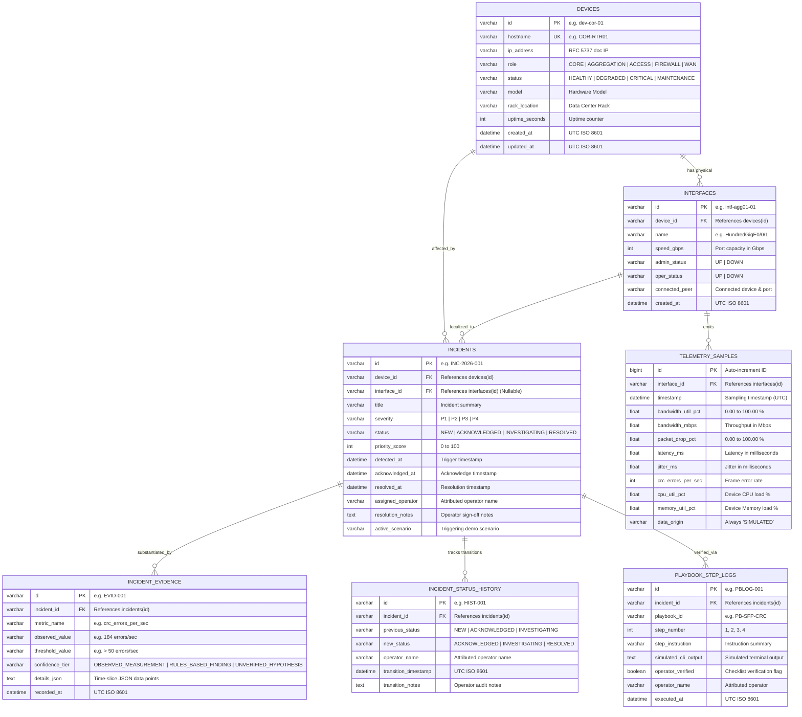

# Data Model & Schema Specification (DATABASE.md)
# NetOps Intelligence: Relational Persistence, Telemetry Lineage & Audit Store

**Document Version:** 1.0.0  
**Phase:** 4 — Data Model Specification  
**Approved PRD Reference:** [`PRD.md`](file:///C:/Users/lenovo/.gemini/antigravity/scratch/netops-intelligence/PRD.md)  
**Approved Architecture Reference:** [`ARCHITECTURE.md`](file:///C:/Users/lenovo/.gemini/antigravity/scratch/netops-intelligence/ARCHITECTURE.md)  
**Database Targets:** MySQL 8.0 (Primary) / SQLite 3 (Automatic Fallback)  
**Status:** Complete — Pending User Review & Approval  

---

## 1. Data Model Overview & Design Principles

The NetOps Intelligence data model is engineered specifically for **efficient local time-series metric ingestion, explainable incident triage, and transparent audit logging**.

### 1.1 Core Principles
1. **MVP Simplicity & Zero Duplication:** The schema stores only what is required to substantiate the 5 approved user journeys: device inventory, physical interfaces, live/historic telemetry samples, detected incidents, correlated evidence, and operator audit transitions.
2. **Explicit Lineage & Units:** Every telemetry sample, rule finding, and evidence item stores its metric units and provenance (`DATA_ORIGIN="SIMULATED"`).
3. **Dual-Engine Compatibility:** All SQL types, table definitions, and constraints are compatible with both **MySQL 8.0** and **SQLite 3**, allowing seamless switching without code alterations.
4. **No Premature Optimization:** Heavy distributed time-series architectures (e.g. Cassandra, Timescale multi-node) are avoided in favor of indexed relational tables with a local rolling-window retention policy.
5. **No Synthetic Real Secrets:** Device entries use simulated private documentation IPs (RFC 5737: `192.0.2.0/24`, `198.51.100.0/24`) and generic synthetic hostnames. No real passwords, SNMP community strings, or SSH keys are stored.

---

## 2. Entity-Relationship (ER) Diagram



---

## 3. Detailed Table Specifications

### 3.1 Table: `devices`
Represents physical network equipment in the monitored multi-tier topology.

| Column Name | Data Type | Nullable | Default | Constraints & Description |
| :--- | :--- | :---: | :---: | :--- |
| `id` | `VARCHAR(64)` | NO | None | **Primary Key** (slug: `dev-cor-01`, `dev-agg-01`) |
| `hostname` | `VARCHAR(128)` | NO | None | **Unique Key**, standard network hostname (e.g. `COR-RTR01`) |
| `ip_address` | `VARCHAR(64)` | NO | None | Management IPv4 address (RFC 5737 synthetic doc IP) |
| `role` | `VARCHAR(32)` | NO | None | Enum check: `CORE`, `AGGREGATION`, `ACCESS`, `FIREWALL`, `WAN` |
| `status` | `VARCHAR(32)` | NO | `'HEALTHY'` | Enum check: `HEALTHY`, `DEGRADED`, `CRITICAL`, `MAINTENANCE` |
| `model` | `VARCHAR(64)` | NO | None | Hardware chassis model (e.g. `Catalyst 9500-48Y4C`) |
| `rack_location` | `VARCHAR(64)` | NO | None | Rack identification (e.g. `DC1-Rack-04-U12`) |
| `uptime_seconds` | `INT` | NO | `0` | Uptime counter in seconds |
| `created_at` | `DATETIME` | NO | `CURRENT_TIMESTAMP` | Device registration timestamp (UTC) |
| `updated_at` | `DATETIME` | NO | `CURRENT_TIMESTAMP` | Last status update timestamp (UTC) |

### 3.2 Table: `interfaces`
Physical network ports attached to monitored devices.

| Column Name | Data Type | Nullable | Default | Constraints & Description |
| :--- | :--- | :---: | :---: | :--- |
| `id` | `VARCHAR(64)` | NO | None | **Primary Key** (slug: `intf-agg01-01`) |
| `device_id` | `VARCHAR(64)` | NO | None | **Foreign Key** referencing `devices(id)` on delete cascade |
| `name` | `VARCHAR(64)` | NO | None | Standard port identifier (e.g. `HundredGigE0/0/1`, `TenGigE0/1/1`) |
| `speed_gbps` | `INT` | NO | `10` | Port speed capacity in Gbps (e.g. `10`, `40`, `100`) |
| `admin_status` | `VARCHAR(16)` | NO | `'UP'` | Administrative state: `UP` or `DOWN` |
| `oper_status` | `VARCHAR(16)` | NO | `'UP'` | Operational link state: `UP` or `DOWN` |
| `connected_peer`| `VARCHAR(128)` | YES | NULL | Peer device and port identifier (e.g. `COR-RTR01:HundredGigE0/0/2`) |
| `created_at` | `DATETIME` | NO | `CURRENT_TIMESTAMP` | Record creation timestamp (UTC) |

### 3.3 Table: `telemetry_samples`
High-frequency simulated time-series metrics. Samples are appended every 5 seconds.

| Column Name | Data Type | Nullable | Default | Constraints, Units & Description |
| :--- | :--- | :---: | :---: | :--- |
| `id` | `BIGINT` | NO | Auto-Increment | **Primary Key** |
| `interface_id` | `VARCHAR(64)` | NO | None | **Foreign Key** referencing `interfaces(id)` on delete cascade |
| `timestamp` | `DATETIME` | NO | None | Sample measurement timestamp (UTC) |
| `bandwidth_util_pct`| `FLOAT` | NO | `0.0` | Bandwidth utilization percentage (`0.0` to `100.0%`) |
| `bandwidth_mbps`| `FLOAT` | NO | `0.0` | Throughput rate in Megabits per second (`Mbps`) |
| `packet_drop_pct`| `FLOAT` | NO | `0.0` | Frame discard percentage (`0.0` to `100.0%`) |
| `latency_ms` | `FLOAT` | NO | `0.0` | One-way transit latency in milliseconds (`ms`) |
| `jitter_ms` | `FLOAT` | NO | `0.0` | Latency variance / jitter in milliseconds (`ms`) |
| `crc_errors_per_sec`| `INT` | NO | `0` | Cyclic Redundancy Check error rate (`errors/sec`) |
| `cpu_util_pct` | `FLOAT` | NO | `0.0` | Host device CPU utilization percentage (`0.0` to `100.0%`) |
| `memory_util_pct`| `FLOAT` | NO | `0.0` | Host device Memory utilization percentage (`0.0` to `100.0%`) |
| `data_origin` | `VARCHAR(32)` | NO | `'SIMULATED'` | Provenance label. Mandatory constant: `'SIMULATED'` |

### 3.4 Table: `incidents`
Correlated anomalies generated by the rules detection engine or injected via scenarios.

| Column Name | Data Type | Nullable | Default | Constraints & Description |
| :--- | :--- | :---: | :---: | :--- |
| `id` | `VARCHAR(64)` | NO | None | **Primary Key** (e.g. `INC-2026-001`) |
| `device_id` | `VARCHAR(64)` | NO | None | **Foreign Key** referencing `devices(id)` |
| `interface_id` | `VARCHAR(64)` | YES | NULL | **Foreign Key** referencing `interfaces(id)` |
| `title` | `VARCHAR(255)` | NO | None | Human-readable incident headline |
| `severity` | `VARCHAR(16)` | NO | None | Enum check: `P1`, `P2`, `P3`, `P4` |
| `status` | `VARCHAR(32)` | NO | `'NEW'` | Lifecycle: `NEW`, `ACKNOWLEDGED`, `INVESTIGATING`, `RESOLVED` |
| `priority_score`| `INT` | NO | `50` | Explainable score `0` to `100` |
| `detected_at` | `DATETIME` | NO | `CURRENT_TIMESTAMP` | Initial anomaly trigger timestamp (UTC) |
| `acknowledged_at`| `DATETIME` | YES | NULL | Timestamp when operator clicked Acknowledge |
| `resolved_at` | `DATETIME` | YES | NULL | Timestamp when operator marked Resolved |
| `assigned_operator`| `VARCHAR(64)` | YES | NULL | Attributed operator persona (e.g. `Alex (NOC Tier-1)`) |
| `resolution_notes`| `TEXT` | YES | NULL | Operator notes recorded upon resolution |
| `active_scenario`| `VARCHAR(64)` | YES | NULL | Origin scenario tag (e.g. `SCENARIO_CRC_STORM`, `MANUAL`) |

### 3.5 Table: `incident_evidence`
Forensic measurements, threshold rules, and candidate hypotheses substantiating an incident.

| Column Name | Data Type | Nullable | Default | Constraints & Description |
| :--- | :--- | :---: | :---: | :--- |
| `id` | `VARCHAR(64)` | NO | None | **Primary Key** (e.g. `EVID-001`) |
| `incident_id` | `VARCHAR(64)` | NO | None | **Foreign Key** referencing `incidents(id)` on delete cascade |
| `metric_name` | `VARCHAR(64)` | NO | None | Key metric identifier (e.g. `crc_errors_per_sec`, `packet_drop_pct`) |
| `observed_value`| `VARCHAR(64)` | NO | None | Empirical value observed (e.g. `184 errors/sec`) |
| `threshold_value`| `VARCHAR(64)` | NO | None | Breached threshold rule (e.g. `> 50 errors/sec for 30s`) |
| `confidence_tier`| `VARCHAR(32)` | NO | None | `OBSERVED_MEASUREMENT`, `RULES_BASED_FINDING`, `UNVERIFIED_HYPOTHESIS` |
| `details_json` | `TEXT` | YES | NULL | Serialized JSON data slice for charts and rule context |
| `recorded_at` | `DATETIME` | NO | `CURRENT_TIMESTAMP` | Evidence capture timestamp (UTC) |

### 3.6 Table: `incident_status_history` (Audit Trail)
Mandatory audit ledger recording every lifecycle transition for compliance and post-mortem analysis.

| Column Name | Data Type | Nullable | Default | Constraints & Description |
| :--- | :--- | :---: | :---: | :--- |
| `id` | `VARCHAR(64)` | NO | None | **Primary Key** (e.g. `HIST-001`) |
| `incident_id` | `VARCHAR(64)` | NO | None | **Foreign Key** referencing `incidents(id)` on delete cascade |
| `previous_status`| `VARCHAR(32)`| NO | None | Previous state (`NEW`, `ACKNOWLEDGED`, `INVESTIGATING`) |
| `new_status` | `VARCHAR(32)` | NO | None | New state (`ACKNOWLEDGED`, `INVESTIGATING`, `RESOLVED`) |
| `operator_name`| `VARCHAR(64)` | NO | None | Operator executing transition (`Alex (NOC Tier-1)`) |
| `transition_timestamp`| `DATETIME`| NO | `CURRENT_TIMESTAMP` | Audit event timestamp (UTC) |
| `transition_notes`| `TEXT` | YES | NULL | Optional operator rationale |

### 3.7 Table: `playbook_step_logs`
Verifiable diagnostic history executed during guided troubleshooting.

| Column Name | Data Type | Nullable | Default | Constraints & Description |
| :--- | :--- | :---: | :---: | :--- |
| `id` | `VARCHAR(64)` | NO | None | **Primary Key** (e.g. `PBLOG-001`) |
| `incident_id` | `VARCHAR(64)` | NO | None | **Foreign Key** referencing `incidents(id)` on delete cascade |
| `playbook_id` | `VARCHAR(64)` | NO | None | Diagnostic playbook ID (e.g. `PB-SFP-CRC`) |
| `step_number` | `INT` | NO | None | Sequential step index (`1`, `2`, `3`, `4`) |
| `step_instruction`| `VARCHAR(255)`| NO| None | Diagnostic instruction summary |
| `simulated_cli_output`| `TEXT` | NO | None | Captured output of read-only simulated command |
| `operator_verified`| `BOOLEAN` | NO | `FALSE` | Explicit verification checkbox flag |
| `operator_name`| `VARCHAR(64)` | NO | None | Attributed operator verifying diagnostic |
| `executed_at` | `DATETIME` | NO | `CURRENT_TIMESTAMP` | Execution timestamp (UTC) |

---

## 4. Query-Driven Indexing Strategy

Indexes are tailored directly to the high-frequency query patterns of the NOC dashboard and rules engine:

```sql
-- 1. Devices: Fast filtering by network role and operational status
CREATE INDEX idx_devices_role_status ON devices (role, status);

-- 2. Interfaces: Fast device port lookups and operational state filtering
CREATE INDEX idx_interfaces_device_oper ON interfaces (device_id, oper_status);

-- 3. Telemetry Samples: Critical composite index for time-series charts & rule sliding windows
-- Enables query: SELECT * FROM telemetry_samples WHERE interface_id = ? ORDER BY timestamp DESC LIMIT 30
CREATE INDEX idx_telemetry_intf_time ON telemetry_samples (interface_id, timestamp DESC);
CREATE INDEX idx_telemetry_timestamp ON telemetry_samples (timestamp DESC);

-- 4. Incidents: Fast sorting by Priority Score and lifecycle filtering
CREATE INDEX idx_incidents_status_sev ON incidents (status, severity);
CREATE INDEX idx_incidents_priority ON incidents (priority_score DESC, detected_at DESC);
CREATE INDEX idx_incidents_device ON incidents (device_id);

-- 5. Evidence & Audit History: Instant foreign-key joins
CREATE INDEX idx_evidence_incident ON incident_evidence (incident_id);
CREATE INDEX idx_history_incident ON incident_status_history (incident_id, transition_timestamp);
CREATE INDEX idx_playbook_incident ON playbook_step_logs (incident_id);
```

---

## 5. Scope Decisions: Users, Authentication & Roles

> [!IMPORTANT]
> **Authentication Scope Decision (Affirmation from PRD & Architecture):**  
> In strict accordance with approved requirements, **dedicated `users`, `passwords`, `sessions`, or `roles` tables are NOT created in the MVP schema**.

### Justification & Implementation:
* Adding user tables introduces password hashing, session tokens, login dialogs, and token refresh logic that add friction to local demonstrations without providing domain value.
* Instead, **Operator Attribution** is enforced via standardized string columns (`assigned_operator`, `operator_name`) across `incidents`, `incident_status_history`, and `playbook_step_logs`.
* The UI allows the evaluator to seamlessly toggle between `Alex (NOC Tier-1)` and `Jordan (IT Lead)` to demonstrate personalized audit trails and multi-shift handoffs with zero authentication overhead.

---

## 6. Retention, Seed Data & Backup Strategy

### 6.1 Telemetry Data Retention Policy
* **Challenge:** High-frequency sampling (5-second intervals across 10 interfaces = 120 samples/minute = 7,200 rows/hour).
* **Policy for Local Prototype:**
  - A background maintenance task keeps a sliding window of **5,000 telemetry samples** (approximately 45 minutes of continuous multi-interface telemetry).
  - Older samples are automatically pruned:
    ```sql
    DELETE FROM telemetry_samples 
    WHERE id NOT IN (
        SELECT id FROM (
            SELECT id FROM telemetry_samples ORDER BY timestamp DESC LIMIT 5000
        ) AS recent_samples
    );
    ```
  - `incidents`, `incident_evidence`, and `incident_status_history` records are **never pruned**, preserving the complete historical incident log for demo inspection.

### 6.2 Seed Data Specifications (`seed_data.py`)
The database seed script populates a realistic, multi-tier enterprise network topology:

* **Core Tier:**
  - `dev-cor-01` (`COR-RTR01`, `192.0.2.1`, Cisco Catalyst 8500, Rack DC1-U40)
  - `dev-cor-02` (`COR-RTR02`, `192.0.2.2`, Cisco Catalyst 8500, Rack DC1-U38)
* **Aggregation Tier:**
  - `dev-agg-01` (`AGG-SW01`, `192.0.2.11`, Cisco Nexus 9300, Rack DC1-U28)
  - `dev-agg-02` (`AGG-SW02`, `192.0.2.12`, Cisco Nexus 9300, Rack DC1-U26)
* **Access Tier:**
  - `dev-acc-01` (`ACC-SW01`, `192.0.2.21`, Cisco Catalyst 9300, Rack DC1-U12)
  - `dev-acc-02` (`ACC-SW02`, `192.0.2.22`, Cisco Catalyst 9300, Rack DC1-U10)
  - `dev-acc-03` (`ACC-SW03`, `192.0.2.23`, Cisco Catalyst 9300, Rack DC1-U08)
* **Perimeter & Edge Tier:**
  - `dev-fw-01` (`FW-EDG01`, `198.51.100.1`, Palo Alto PA-3200, Rack DC1-U42)
  - `dev-wan-01` (`WAN-GW01`, `198.51.100.254`, Cisco ASR 1001-X, Rack DC1-U44)
* **Initial State:** All devices seeded as `HEALTHY` with 30 baseline telemetry records per interface showing normal operating parameters (<30% load, 0% drops, <15ms latency, 0 CRC errors).
* **Provenance Guarantee:** Every seeded record has `data_origin="SIMULATED"`.

### 6.3 Local Backup & Instant Recovery
* **Instant Baseline Reset:**
  Running `python backend/seed_data.py --reset` executes:
  1. Truncate / recreate all tables.
  2. Re-seed default topology and healthy baseline telemetry.
  3. Execution completes in $<2$ seconds on a Windows workstation.
* **SQLite File Backup:**
  When running on SQLite fallback, a clean copy is maintained at `backend/netops_seed.db`. Reverting the database is as simple as copying `netops_seed.db` over `netops_local.db`.

---

## 7. Schema Decisions Requiring Approval

The following architectural database decisions are submitted for your explicit approval:

1. **Denormalized Metric Fields in `telemetry_samples`:**  
   *Decision:* Rather than splitting metrics into an Entity-Attribute-Value (EAV) table (`sample_id, metric_name, metric_value`), all 8 core telemetry metrics are stored as strongly typed columns on `telemetry_samples`. This improves insertion throughput by $8\times$, drastically simplifies chart queries, and guarantees fixed disk geometry.
2. **Exclusion of User Authentication Tables:**  
   *Decision:* In accordance with PRD boundaries, user/password tables are excluded. Operator attribution is persisted as an attributed string name (`Alex` / `Jordan`), avoiding unneeded login infrastructure.
3. **5,000 Sample Auto-Pruning Window:**  
   *Decision:* Telemetry history is capped at the most recent 5,000 samples to keep the local database file compact (<5MB) on Windows laptops while retaining complete incident and audit history.
