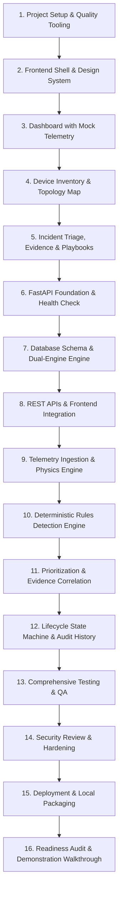

# Master Implementation Plan (IMPLEMENTATION_PLAN.md)
# NetOps Intelligence: Serial, Dependency-Aware Engineering Roadmap

**Document Version:** 1.0.0  
**Phase:** 7 — Implementation Planning  
**Approved References:** [`PRD.md`](file:///C:/Users/lenovo/.gemini/antigravity/scratch/netops-intelligence/PRD.md), [`DESIGN.md`](file:///C:/Users/lenovo/.gemini/antigravity/scratch/netops-intelligence/DESIGN.md), [`ARCHITECTURE.md`](file:///C:/Users/lenovo/.gemini/antigravity/scratch/netops-intelligence/ARCHITECTURE.md), [`DATABASE.md`](file:///C:/Users/lenovo/.gemini/antigravity/scratch/netops-intelligence/DATABASE.md), [`API.md`](file:///C:/Users/lenovo/.gemini/antigravity/scratch/netops-intelligence/API.md), [`AGENTS.md`](file:///C:/Users/lenovo/.gemini/antigravity/scratch/netops-intelligence/AGENTS.md)  
**Execution Strategy:** Strict Serial Execution with Gatekeeper Sign-Off  
**Status:** Complete — Pending User Review & Approval  

---

## 1. Plan Overview & Execution Principles

This implementation plan establishes the **16 serial, dependency-aware phases** required to build NetOps Intelligence from clean foundation to production-grade demonstration prototype.

### Core Execution Guarantees
1. **Frontend-First Prototype Strategy:** In alignment with PRD and Architecture boundaries, Phases 1–5 deliver a complete, high-fidelity frontend prototype with an interactive simulated store before backend server and persistence plumbing are constructed.
2. **Deterministic Rules Before ML:** Machine learning or statistical baselines are never introduced before reliable, deterministic baseline behavior is verified.
3. **No Premature Feature Implementation:** Features are implemented strictly within their assigned phase. No code is written during planning.
4. **Enforceable Acceptance Gates:** Every phase must pass its explicit test and verification commands on Windows PowerShell before advancing.

---

## 2. Phase-by-Phase Dependency Graph

---

## 3. Serial Phase Specifications

---

### Phase 1: Project Setup & Quality Tooling
* **Goal & Scope:** Initialize frontend and backend repository structures, install base toolchains, configure TypeScript strict mode, ESLint, Tailwind CSS, Python virtual environment, and Pytest on Windows PowerShell.
* **Tasks & Likely Files:**
  - Initialize Vite React + TypeScript in `frontend/` (`frontend/package.json`, `frontend/tsconfig.json`, `frontend/vite.config.ts`).
  - Configure Tailwind CSS with NOC dark palette tokens (`frontend/tailwind.config.js`, `frontend/postcss.config.js`, `frontend/src/index.css`).
  - Configure Lucide React icons and Recharts dependencies in `frontend/package.json`.
  - Initialize Python virtual environment `venv` in root; author `backend/requirements.txt` (FastAPI, Uvicorn, SQLAlchemy, PyMySQL, Pydantic, Pytest, HTTPX).
  - Create baseline `.gitignore` protecting `.env`, `node_modules`, `venv`, and `__pycache__`.
* **Prerequisites:** Approved `ARCHITECTURE.md` and `AGENTS.md`. Node.js 24+ and Python 3.14+ installed.
* **API / Database Impact:** None.
* **Tests & Manual Checks:**
  - `cd frontend; npm.cmd install; npm.cmd run build` (Exit code 0).
  - `python -m venv venv; .\venv\Scripts\Activate.ps1; pip install -r backend\requirements.txt`.
* **Acceptance Criteria:** Frontend builds with zero TypeScript errors. Python environment installs cleanly.
* **Risks & Rollback:** PowerShell script execution policy blocks `npm.ps1`. *Mitigation:* Explicitly standardize on `npm.cmd`. Rollback: Remove `frontend/` and `venv` directories.

---

### Phase 2: Frontend Shell & Design System
* **Goal & Scope:** Implement the global application frame, persistent header, system health pill, UTC clock, operator persona switcher, scenario injection bar, tab navigation, and shared design tokens adhering strictly to `DESIGN.md`.
* **Tasks & Likely Files:**
  - Create design tokens and root CSS variables in `frontend/src/index.css`.
  - Author reusable shared components in `frontend/src/components/common/`:
    - `Header.tsx` (Logo, `[SIMULATED DATA]` badge, live UTC clock, health indicator).
    - `PersonaSwitcher.tsx` (`Alex (NOC Tier-1)` vs `Jordan (IT Lead)` toggle).
    - `ScenarioBar.tsx` (Quick-toggle toolbar for Normal, SFP CRC Storm, WAN Congestion, BGP Flap).
    - `StatusBadge.tsx` (Multi-channel color + glyph + text).
    - `SeverityBadge.tsx` (`P1` to `P4` with distinct shapes).
  - Build main app shell layout in `frontend/src/App.tsx`.
* **Prerequisites:** Phase 1 complete.
* **API / Database Impact:** None (pure presentation shell).
* **Tests & Manual Checks:**
  - `npm.cmd run build` verifies zero TypeScript compilation errors.
  - `npm.cmd run dev` manual inspection: shell loads at `http://localhost:5173`, header, tabs, and scenario bar render with dark NOC styling.
* **Acceptance Criteria:** Header displays persistent `[SIMULATED DATA]` badge; persona toggle updates active operator state; navigation tabs switch active view.
* **Risks & Rollback:** CSS contrast failure. *Mitigation:* Verify contrast against WCAG 2.1 AA standards.

---

### Phase 3: Dashboard with Clearly Labeled Mock Data
* **Goal & Scope:** Implement the primary NOC Executive Dashboard (`/`) featuring 4 summary KPI cards, recent incident feed, and aggregate telemetry sparklines using realistic mock data.
* **Tasks & Likely Files:**
  - Define TypeScript domain models in `frontend/src/types/`: `device.ts`, `telemetry.ts`, `incident.ts`.
  - Author `frontend/src/components/common/MetricCard.tsx` (Value, unit, trend arrow, sparkline, provenance tag).
  - Author `frontend/src/components/dashboard/KPIGrid.tsx` (Total Devices, Online Interfaces, Aggregated Drop Rate, Average Latency).
  - Author `frontend/src/components/dashboard/RecentAlertsFeed.tsx` (Live stream of top active incidents).
  - Author `frontend/src/services/mockData.ts` (Realistic initial seed data with `data_origin="SIMULATED"`).
  - Author `frontend/src/store/useNetOpsStore.ts` (Reactive state store holding devices, incidents, active scenario).
* **Prerequisites:** Phase 2 complete.
* **API / Database Impact:** None (client-side state).
* **Tests & Manual Checks:**
  - `npm.cmd run build` passes with zero type errors.
  - Manual UI check: Dashboard renders all 4 KPI cards and alert feed cleanly without layout jitter.
* **Acceptance Criteria:** All metric values display units (`%`, `Mbps`, `ms`); all simulated metrics display `[SIM]` provenance badges; dashboard loads in $<1.5$ seconds.
* **Risks & Rollback:** Overly complex state store. *Mitigation:* Use lightweight reactive store pattern; avoid heavy Redux.

---

### Phase 4: Device Inventory & Topology Visualization
* **Goal & Scope:** Implement the Tiered Topology Visualizer and searchable/filterable Device Inventory table with interface inspection drawer.
* **Tasks & Likely Files:**
  - Author `frontend/src/components/topology/TopologyMap.tsx` (Tiered Core $\rightarrow$ Aggregation $\rightarrow$ Access $\rightarrow$ Perimeter layout with link status and bandwidth load bars).
  - Author `frontend/src/components/topology/DeviceCard.tsx` (Compact node with hostname, IP, role, health badge).
  - Author `frontend/src/components/devices/DeviceTable.tsx` (Searchable device list with role and status filter pills).
  - Author `frontend/src/components/devices/InterfaceDrawer.tsx` (Slide-over drawer displaying physical ports, speed, admin/oper status, connected peers, and throughput sparklines).
* **Prerequisites:** Phase 3 complete.
* **API / Database Impact:** None.
* **Tests & Manual Checks:**
  - `npm.cmd run build` passes cleanly.
  - Manual verification: Filtering by `AGGREGATION` filters the table; clicking `AGG-SW01` opens the interface drawer showing `HundredGigE0/0/1`.
* **Acceptance Criteria:** Topology visualizer groups devices by tier; link colors reflect load (Green $<70\%$, Amber $70\text{--}90\%$, Red $>90\%$); interface drawer displays full port metadata.
* **Risks & Rollback:** Large SVG graph rendering overhead. *Mitigation:* Clean flex/grid tiered node layout with lightweight SVG link connectors.

---

### Phase 5: Incident List/Details, Evidence Inspector & Playbooks
* **Goal & Scope:** Implement the Incident Triage Console with P1–P4 severity filtering, Priority Score sorting, Evidence Inspector split-view/modal, and Guided Troubleshooting Playbook runner.
* **Tasks & Likely Files:**
  - Author `frontend/src/components/incidents/IncidentTable.tsx` (Sortable incident rows with severity badge, priority meter `0–100`, status pill, age).
  - Author `frontend/src/components/incidents/IncidentFilterToolbar.tsx` (Severity pills, lifecycle filter, search).
  - Author `frontend/src/components/evidence/EvidenceInspector.tsx` (Correlated time-series charts, observed measurements table, rule finding explanation, and `UNVERIFIED HYPOTHESIS` card).
  - Author `frontend/src/components/playbooks/PlaybookRunner.tsx` (Interactive diagnostic checklist, simulated CLI terminal output, verification checkbox, operator sign-off).
  - Wire Scenario Injection Bar in `useNetOpsStore.ts` so selecting `SFP CRC Storm` dynamically injects a P1 incident and updates the Evidence Inspector.
* **Prerequisites:** Phase 4 complete.
* **API / Database Impact:** None (fully interactive client-side prototype).
* **Tests & Manual Checks:**
  - `npm.cmd run build` passes with zero type errors.
  - Interactive walkthrough: Select `SFP CRC Storm` $\rightarrow$ verify P1 incident appears $\rightarrow$ click row $\rightarrow$ verify Evidence Inspector opens with CRC chart spike $\rightarrow$ run Playbook $\rightarrow$ verify simulated optical reading $\rightarrow$ mark Resolved.
* **Acceptance Criteria:** Full 5-minute interactive demonstration flow works offline in the browser; data lineage badges (`SIMULATED DATA`, `OBSERVED MEASUREMENT`, `UNVERIFIED HYPOTHESIS`) are prominently visible.
* **Risks & Rollback:** Complex playbook state machine. *Mitigation:* Strict linear step progression with clear checklist validation.

---

### Phase 6: FastAPI Foundation & Health Check
* **Goal & Scope:** Establish the Python FastAPI backend modular monolith structure, settings management via `.env`, CORS middleware, structured JSON logging, and the `/api/health` readiness endpoint.
* **Tasks & Likely Files:**
  - Author `backend/app/config.py` (Pydantic `BaseSettings` reading `.env`).
  - Author `backend/app/main.py` (FastAPI initialization, CORS middleware, error handlers, OpenAPI metadata).
  - Author `backend/app/routers/health.py` (`GET /api/health` implementation returning DB and simulation status).
  - Author `backend/tests/test_health.py` (Pytest test suite validating `/api/health`).
* **Prerequisites:** Phase 5 complete. Python `venv` initialized.
* **API / Database Impact:** Exposes `GET /api/health` and OpenAPI docs at `/docs`.
* **Tests & Manual Checks:**
  - `pytest backend\tests\test_health.py -v` (Exit code 0, 100% pass).
  - `uvicorn backend.app.main:app --port 8000` $\rightarrow$ inspect `http://localhost:8000/docs` in browser.
* **Acceptance Criteria:** `/api/health` returns `200 OK` with JSON matching `API.md` schema; OpenAPI documentation renders cleanly.
* **Risks & Rollback:** Port 8000 conflict on Windows. *Mitigation:* Configurable `API_PORT` in `.env`.

---

### Phase 7: Database Schema, Dual-Engine Engine & Seed Data
* **Goal & Scope:** Implement declarative SQLAlchemy 2.0 ORM models for all 7 tables defined in `DATABASE.md`, implement automatic SQLite fallback in `database.py`, and create the idempotent `seed_data.py` script.
* **Tasks & Likely Files:**
  - Author `backend/app/database.py` (Dual-engine connection manager: attempts MySQL 8.0, gracefully falls back to local SQLite `./backend/netops_local.db`).
  - Author SQLAlchemy declarative models in `backend/app/models/`:
    - `device.py`, `interface.py`, `telemetry.py`, `incident.py`, `evidence.py`, `history.py`, `playbook.py`.
  - Author `backend/seed_data.py` (Idempotent seed script populating 9 devices across Core/Agg/Access/WAN tiers, interfaces, and baseline telemetry tagged `SIMULATED`).
  - Author `backend/tests/test_database.py` (Validates model creation and seed data insertion in an in-memory SQLite database).
* **Prerequisites:** Phase 6 complete.
* **API / Database Impact:** Creates database tables and indexes in MySQL 8.0 or `netops_local.db`.
* **Tests & Manual Checks:**
  - `python backend/seed_data.py --reset` executes in $<2$ seconds.
  - `pytest backend\tests\test_database.py -v` passes cleanly.
* **Acceptance Criteria:** All 7 tables and 8 indexes created without SQL errors; 9 devices seeded with status `HEALTHY` and documentation IPs (`192.0.2.0/24`); zero secrets stored.
* **Risks & Rollback:** MySQL authentication failure. *Mitigation:* Automatic SQLite fallback is triggered immediately with warning log.

---

### Phase 8: Device, Metric & Incident APIs with Frontend Connection
* **Goal & Scope:** Implement FastAPI REST routers for Devices, Telemetry, and Incidents matching `API.md`; configure Vite proxy in `frontend/vite.config.ts`; connect React frontend to live FastAPI endpoints.
* **Tasks & Likely Files:**
  - Author Pydantic v2 schemas in `backend/app/schemas/`: `device.py`, `telemetry.py`, `incident.py`.
  - Author routers in `backend/app/routers/`:
    - `devices.py` (`GET /api/devices`, `GET /api/devices/{id}`).
    - `telemetry.py` (`GET /api/telemetry/live`, `GET /api/telemetry/history`).
    - `incidents.py` (`GET /api/incidents`, `GET /api/incidents/{id}`).
  - Configure Vite proxy in `frontend/vite.config.ts` (`/api` $\rightarrow$ `http://localhost:8000`).
  - Update `frontend/src/services/api.ts` to fetch from live backend REST endpoints with fallback to local mock store if offline.
* **Prerequisites:** Phase 7 complete.
* **API / Database Impact:** Exposes core reading endpoints; read queries against database.
* **Tests & Manual Checks:**
  - `pytest backend\tests\test_api.py -v` passes with all HTTP status codes validated.
  - Launch backend and frontend simultaneously: Frontend displays devices and telemetry retrieved directly from FastAPI.
* **Acceptance Criteria:** Frontend renders live data from database via FastAPI; RFC 7807 problem details returned on invalid device query (`404 Not Found`).
* **Risks & Rollback:** CORS mismatch. *Mitigation:* Explicit CORS origins (`http://localhost:5173`) configured in FastAPI.

---

### Phase 9: Telemetry Ingestion & Physics Simulation Engine
* **Goal & Scope:** Implement the background telemetry simulation engine (`SimulatedTelemetryProvider`) that generates physics-consistent metric samples every 5 seconds and persists them with retention pruning.
* **Tasks & Likely Files:**
  - Author `backend/app/services/simulation.py` (`ITelemetryProvider` interface and `SimulatedTelemetryProvider` implementation with physics-based random walk and scenario injection).
  - Implement 5-second asynchronous background loop in FastAPI lifecycle (`lifespan`).
  - Implement rolling retention pruner capping `telemetry_samples` at 5,000 rows.
  - Author `backend/app/routers/scenarios.py` (`GET /api/scenarios`, `POST /api/scenarios/inject`, `POST /api/scenarios/reset`).
* **Prerequisites:** Phase 8 complete.
* **API / Database Impact:** Writes continuous rows to `telemetry_samples` with `data_origin="SIMULATED"`.
* **Tests & Manual Checks:**
  - Verify database sample count grows by 10 samples every 5 seconds.
  - `POST /api/scenarios/inject` with `SCENARIO_CRC_STORM` $\rightarrow$ verify CRC error rate spikes on `AGG-SW01:HundredGigE0/0/1`.
  - `pytest backend\tests\test_simulation.py -v` passes cleanly.
* **Acceptance Criteria:** Telemetry metrics obey network physics (CRC errors induce packet drops; bandwidth congestion induces latency); retention pruner keeps table bounded at 5,000 samples.
* **Risks & Rollback:** SQLite write lock contention with high concurrency. *Mitigation:* WAL mode enabled and batch inserts used.

---

### Phase 10: Deterministic Rules-Based Detection Engine
* **Goal & Scope:** Implement the deterministic, explainable rule engine that evaluates sliding telemetry windows to detect network anomalies without false claims of AI certainty.
* **Tasks & Likely Files:**
  - Author `backend/app/services/rule_engine.py` (`IRule` interface and rule registry).
  - Implement concrete rules:
    - `CRCStormRule (CR_002)`: CRC errors $> 50\text{ err/s}$ for 3 consecutive cycles.
    - `WANCongestionRule (WAN_001)`: Bandwidth $> 90\%$ AND drops $> 5\%$.
    - `BGPFlapRule (BGP_003)`: Flaps $\ge 2$ within 60 seconds.
    - `CPUSpikeRule (CPU_004)`: CPU $> 85\%$ for $> 30$ seconds.
  - Connect rule evaluation to the 5-second simulation tick.
  - Author `backend/tests/test_rules_engine.py` (Unit tests verifying rule triggers and false-positive immunity).
* **Prerequisites:** Phase 9 complete.
* **API / Database Impact:** Generates incident candidate records upon threshold violation.
* **Tests & Manual Checks:**
  - `pytest backend\tests\test_rules_engine.py -v` passes with 100% assertions green.
  - Inject `SCENARIO_CRC_STORM` $\rightarrow$ verify rule `CR_002` triggers within 15 seconds.
* **Acceptance Criteria:** Zero hallucinations; every trigger includes exact mathematical condition breached and timestamps.
* **Risks & Rollback:** Flapping alert noise. *Mitigation:* Multi-sample consecutive breach requirement (hysteresis window).

---

### Phase 11: Incident Prioritization & Evidence-Based Explanations
* **Goal & Scope:** Implement the blast-radius priority scoring engine (0–100) and assemble forensic evidence packages linking raw telemetry slices to incidents.
* **Tasks & Likely Files:**
  - Author `backend/app/services/correlation.py`:
    - Priority scoring formula: $\text{Clamp}(0.4 \times \text{TierWeight} + 0.4 \times \text{Severity} + 0.2 \times \text{BlastRadius})$.
    - Evidence packaging: inserts `incident_evidence` rows tagged with `OBSERVED_MEASUREMENT`, `RULES_BASED_FINDING`, and `UNVERIFIED_HYPOTHESIS`.
  - Author `backend/app/routers/evidence.py` (`GET /api/incidents/{id}/evidence`).
  - Update frontend Evidence Inspector to render live evidence from backend.
* **Prerequisites:** Phase 10 complete.
* **API / Database Impact:** Inserts into `incidents` and `incident_evidence`.
* **Tests & Manual Checks:**
  - `pytest backend\tests\test_correlation.py -v` passes.
  - Verify Core incident receives priority $>90$ while Access incident receives priority $<65$.
* **Acceptance Criteria:** Evidence Inspector displays correlated time-series spike graph, observed vs. baseline table, and candidate hypothesis clearly tagged as unverified.
* **Risks & Rollback:** Score overflow. *Mitigation:* Strict clamping to range `[0, 100]`.

---

### Phase 12: Incident Status Lifecycle, Playbooks & Audit History
* **Goal & Scope:** Implement the incident state machine, interactive advisory troubleshooting playbook execution, and immutable status transition audit logging.
* **Tasks & Likely Files:**
  - Implement `PATCH /api/incidents/{id}/status` in `backend/app/routers/incidents.py` enforcing $\text{NEW} \rightarrow \text{ACKNOWLEDGED} \rightarrow \text{INVESTIGATING} \rightarrow \text{RESOLVED}$.
  - Author `backend/app/services/playbook_runner.py` (Catalog of advisory playbooks: `PB-SFP-CRC`, `PB-WAN-CONG`, `PB-BGP-FLAP`, `PB-CPU-STORM` with simulated read-only CLI outputs).
  - Author `backend/app/routers/playbooks.py` (`GET /api/playbooks/{id}`, `POST /api/playbooks/{id}/execute-step`).
  - Persist transition records to `incident_status_history` and `playbook_step_logs`.
  - Author `frontend/src/components/history/AuditHistoryView.tsx` (`/history` page displaying MTTR and resolution timeline).
* **Prerequisites:** Phase 11 complete.
* **API / Database Impact:** Updates `incidents`; inserts `incident_status_history` and `playbook_step_logs`.
* **Tests & Manual Checks:**
  - `pytest backend\tests\test_lifecycle.py -v` passes.
  - Attempt invalid transition (`NEW` $\rightarrow$ `RESOLVED` directly) $\rightarrow$ verify `409 Conflict` returned.
  - Execute diagnostic step $\rightarrow$ verify simulated CLI output and operator attribution recorded in audit history.
* **Acceptance Criteria:** Full lifecycle progression enforced; resolution requires operator notes; audit history displays MTTR and operator name (`Alex`).
* **Risks & Rollback:** Invalid state jumps. *Mitigation:* State transition matrix validated in Pydantic schema and router.

---

### Phase 13: Testing, Accessibility & Responsive QA
* **Goal & Scope:** Execute comprehensive quality assurance across frontend and backend: component tests, API integration tests, WCAG 2.1 AA color contrast audits, keyboard navigation, and responsive layout testing.
* **Tasks & Likely Files:**
  - Author frontend component tests in `frontend/src/tests/` (Vitest + React Testing Library).
  - Verify WCAG 2.1 AA contrast ratios ($\ge 4.5:1$) across all dark NOC theme tokens.
  - Test keyboard navigation shortcuts (`/`, `J`/`K`, `Enter`, `Esc`, `R`).
  - Test responsive layout collapsing on 1280px and 1920px viewports.
  - Verify `prefers-reduced-motion` suppresses chart animations.
* **Prerequisites:** Phase 12 complete.
* **API / Database Impact:** None.
* **Tests & Manual Checks:**
  - `cd frontend; npm.cmd test; npm.cmd run build` (0 failures).
  - `pytest backend\tests -v` (100% test pass).
  - Keyboard-only navigation through incident queue and evidence drawer.
* **Acceptance Criteria:** All test suites green; keyboard navigation functional; zero accessibility contrast violations.
* **Risks & Rollback:** Test flakiness. *Mitigation:* Deterministic mock timers in frontend tests; isolated in-memory SQLite in backend tests.

---

### Phase 14: Security Review & Workstation Hardening
* **Goal & Scope:** Perform automated and manual security verification: ensure zero hardcoded secrets, verify CORS isolation, validate input sanitization, and confirm the strict advisory safety boundary.
* **Tasks & Likely Files:**
  - Execute codebase scan for credentials, tokens, and real IP addresses.
  - Verify all network IP addresses reside in RFC 5737 documentation blocks (`192.0.2.0/24`, `198.51.100.0/24`).
  - Audit backend imports: verify **zero networking write libraries** (Netmiko, Paramiko, Scrapli) exist in the codebase.
  - Verify CORS middleware restricts origins to localhost dev servers.
* **Prerequisites:** Phase 13 complete.
* **API / Database Impact:** None.
* **Tests & Manual Checks:**
  - PowerShell search script searching for `password`, `secret`, `token`, `private_key` across codebase.
  - Verify `.env.example` contains only empty/safe placeholders.
* **Acceptance Criteria:** Zero credentials in source code or git history; no destructive network modification capabilities exist.
* **Risks & Rollback:** Accidental secret commit. *Mitigation:* Verified `.gitignore` and static scan check.

---

### Phase 15: Deployment Preparation & Local Runbook
* **Goal & Scope:** Package the application for seamless, zero-friction local execution on Windows laptops with documented one-click startup scripts.
* **Tasks & Likely Files:**
  - Author `run_local.ps1` (PowerShell launch script that starts FastAPI backend and Vite frontend concurrently).
  - Author `DEMO_GUIDE.md` (Step-by-step evaluator script detailing the 5-minute incident triage walkthrough).
  - Update `README.md` with verified quickstart instructions.
* **Prerequisites:** Phase 14 complete.
* **API / Database Impact:** None.
* **Tests & Manual Checks:**
  - Execute `.\run_local.ps1` from a clean PowerShell terminal.
  - Confirm frontend opens at `http://localhost:5173` and backend API is active at `http://localhost:8000/docs`.
* **Acceptance Criteria:** One-click script boots entire system in $<10$ seconds on a Windows workstation.
* **Risks & Rollback:** Port collisions. *Mitigation:* Script checks port availability before binding.

---

### Phase 16: Monitoring & Final Readiness Audit
* **Goal & Scope:** Execute final end-to-end readiness audit, test all 10 acceptance test cases (`TC-1` to `TC-10`) from `PRD.md`, and verify complete project deliverables.
* **Tasks & Likely Files:**
  - Execute complete test matrix against running application:
    - TC-1: Health overview & KPI rendering.
    - TC-2: Device inventory search & interface drawer.
    - TC-3: Scenario injection (SFP CRC Storm).
    - TC-4: P1 Critical prioritization and queue ordering.
    - TC-5: Evidence Inspector correlation & observed values.
    - TC-6: Hypothesis badging (`UNVERIFIED HYPOTHESIS`).
    - TC-7: State machine transitions (`NEW` $\rightarrow$ `ACK` $\rightarrow$ `INVESTIGATING`).
    - TC-8: Guided Playbook execution & operator verification.
    - TC-9: Non-destructive safety verification.
    - TC-10: Scenario reset to normal baseline.
  - Author final completion report.
* **Prerequisites:** Phase 15 complete.
* **API / Database Impact:** End-to-end full system exercise.
* **Tests & Manual Checks:**
  - All 10 acceptance tests verified live on screen and logged.
* **Acceptance Criteria:** 100% of PRD acceptance test cases pass; zero console errors; demonstrator walkthrough ready.
* **Risks & Rollback:** Live demo glitch. *Mitigation:* Idempotent `--reset` restores system to clean state in 2 seconds.

---

## 4. Immediate Next Step

The first implementation task to execute upon approval is:

> **Phase 1, Task 1.1:** Initialize the Vite + React 19 + TypeScript project in `frontend/`, configure Tailwind CSS with dark NOC theme tokens, and verify clean compilation via `npm.cmd run build`.

*(In strict compliance with instructions and AGENTS.md, no application code has been written during planning. Awaiting your explicit approval and instruction to proceed with Phase 1.)*
